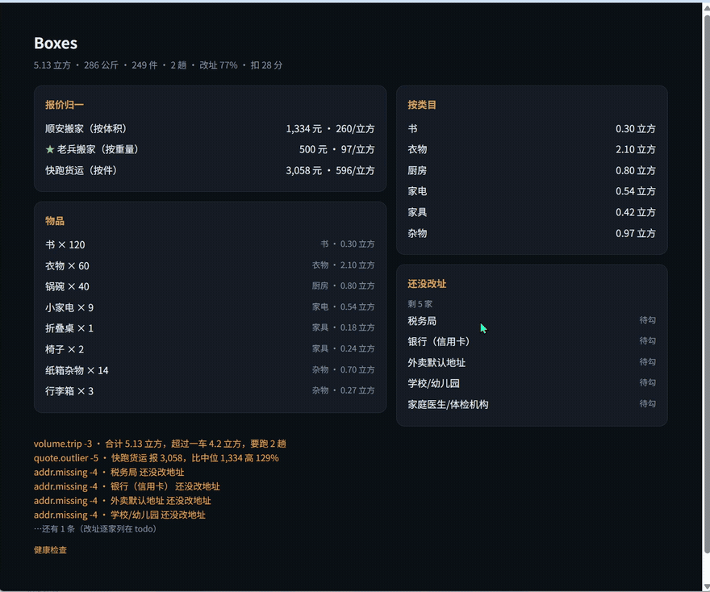
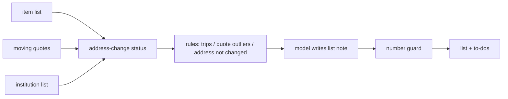

# Boxes · moving plan

[](https://github.com/wushiyi105-jpg/boxes/actions)

[](./LICENSE)



How many cubic metres, how many van trips, and which organisations still have your old address.

## Features

- Multiplies per-item volume by quantity, then rounds up trips at 4.2 m³ per van.
- Normalises three quote styles (by volume, by weight, by item) into a total and a price per m³.
- Flags a quote more than 30% above the median.
- Lists organisations that still hold the old address, with a `notify` command to tick them off.

Rules live in `boxes/domain/rules/`; the CLI and the web layer only call them. The Chinese README lists every `rule_id` with its penalty.

## Quickstart

```bash
pip install -e ".[dev]"
python -m boxes seed
python -m boxes plan
python -m boxes todo
python -m boxes notify --org 税务局
python -m boxes serve        # http://127.0.0.1:8010
```

Run `python -m boxes --help` for the full command list; `docker build -t boxes . && docker run -p 8010:8010 boxes` works the same way.

## Why not just ask a general LLM

Moving quotes are quoted in different units, so the cheapest-looking one is often not the cheapest. Boxes converts all three to the same basis and checks the address list, which is the part people forget.

## When to use it

- You are moving locally and three companies quote differently.
- You need a volume estimate for a small but cluttered flat.

## Roadmap

- Estimate volume from photos.
- Add a cross-city mode with distance and tolls.

## FAQ

**How is volume estimated?**
Per-item volume × quantity; it excludes dismantling and stairs.

**Can it change my address everywhere?**
No, it lists what is left and you tick them off.

**Was the Docker image verified?**
Docker is not installed on the build machine, so `docker build .` was not run and the image is unverified; only the Dockerfile and ports were checked statically.

## Commands

See the Chinese README (`README.md`) for the command table with flags; every command supports `--help`.

## Dependencies

FastAPI + Uvicorn, Jinja2, pydantic / pydantic-settings, httpx, Typer + Rich, SQLAlchemy + Alembic; dev extras add pytest, pytest-cov, respx, freezegun, ruff, mypy, pip-audit. Version pinning lives in `uv.lock`.

## How it works



## Layout

```
boxes/
├── .github/
│   ├── ISSUE_TEMPLATE
│   ├── PULL_REQUEST_TEMPLATE.md
│   └── workflows
├── assets/
│   └── demo.gif
├── boxes/
│   └── … 9 项
├── data/
│   ├── boxes.db
│   └── seed.json
├── migrations/
│   ├── __init__.py
│   ├── env.py
│   ├── script.py.mako
│   └── versions
├── prompts/
│   └── summary.md
├── templates/
│   └── index.html
├── tests/
│   └── … 7 项
├── CHANGELOG.md
├── CODE_OF_CONDUCT.md
├── CONTRIBUTING.md
├── Dockerfile
├── LICENSE
├── README.en.md
├── README.md
├── SECURITY.md
├── alembic.ini
├── pyproject.toml
```

## Author

Luo Zhizhi · GitHub [@wushiyi105-jpg](https://github.com/wushiyi105-jpg) · 15071889700
