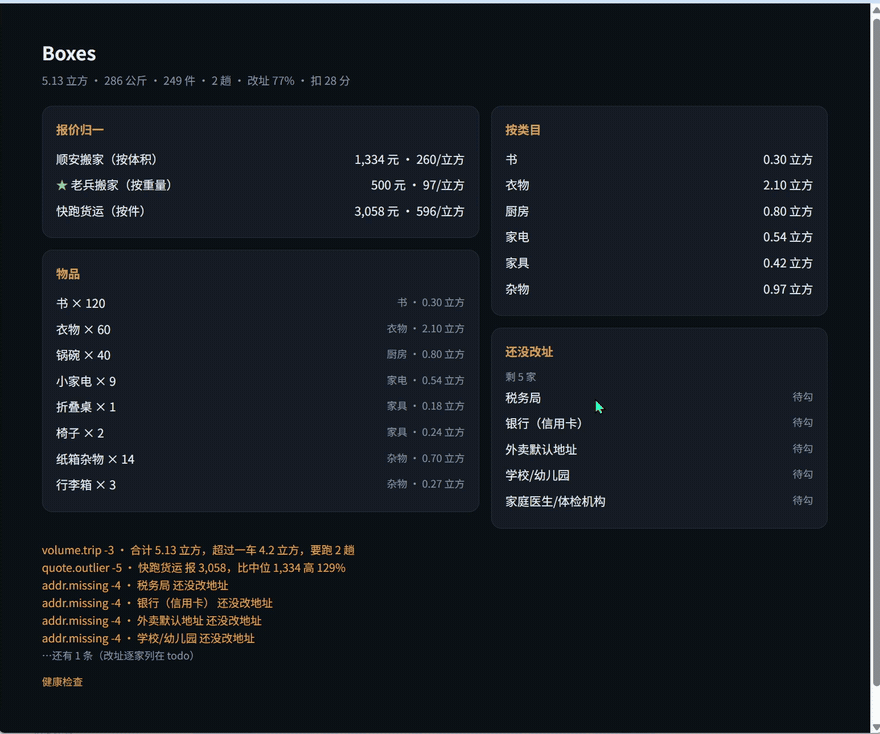

# Boxes · 搬家清单

[](https://github.com/wushiyi105-jpg/boxes/actions)

[](./LICENSE)



搬家前先算清楚：多少立方、要几趟、三家报价怎么比、22 家机构改了几家。

## 为什么不是列个清单就完了

搬家公司的报价口径各不相同：按体积、按重量、按件，直接看总价没法比。Boxes 把三种口径都折成
「总额 + 每立方价」，低于起步价的标注出来；体积超一车（4.2 立方）就提醒几趟；
改址清单 22 家逐个勾，没勾的列出来。

## 它做什么

1. **体积估算**：按类目单件体积 × 数量，合计立方与公斤。
2. **趟数**：按 4.2 立方一车向上取整。
3. **三种计价归一**：按体积 / 按重量 / 按件，统一折成总额与每立方价。
4. **异常报价**：比中位高 30% 以上点名。
5. **改址清单**：22 家机构，缺哪家列哪家。

## 怎么用

```bash
pip install -e ".[dev]"
python -m boxes seed
python -m boxes plan
python -m boxes todo
python -m boxes notify --org 税务局
python -m boxes serve        # http://127.0.0.1:8010
```

真实种子：8 类物品（书 120 本、衣物 60 件、锅碗 40、小家电 9、折叠桌 1、椅子 2、纸箱杂物 14、行李箱 3），
三家报价：顺安按体积 260 元/立方（起步 800）、老兵按重量 1.6 元/公斤（起步 500）、快跑按件 12 元/件
加楼层费 70；22 家机构里 17 家已改址。

`plan` 出来：5.13 立方、285.8 公斤、249 件、要跑 2 趟；顺安 1,334 元（260/立方）、老兵 500 元（低于起步价按 500 算）、
快跑 3,058 元（596/立方，比中位高 129%）；还有 5 家没改址（税务局、信用卡银行、外卖默认地址、学校、体检机构），
合计扣 28 分。

## 规则与扣分

| rule_id | 含义 | 扣分 |
| --- | --- | --- |
| `volume.trip` | 超过一车 4.2 立方 | 3 |
| `quote.outlier` | 报价比中位高 30% 以上 | 5 |
| `addr.missing` | 机构还没改地址 | 4 |
| `guard.number` | 模型写了清单里没有的数 | 8 |

## 边界

- 体积是估算，不含拆装与楼梯；
- 不含保险与赔付；
- 不帮你打电话谈价。

## 作者

shiyi · GitHub [@wushiyi105-jpg](https://github.com/wushiyi105-jpg) · wushiyi105@gmail.com
