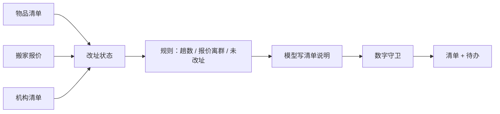

# Boxes · 搬家清单

[](https://github.com/wushiyi105-jpg/boxes/actions)

[](./LICENSE)


搬家前先算清楚：多少立方、要几趟、三家报价怎么比、22 家机构改了几家。


## 功能特性

1. **体积估算**：按类目单件体积 × 数量，合计立方与公斤。
2. **趟数**：按 4.2 立方一车向上取整。
3. **三种计价归一**：按体积 / 按重量 / 按件，统一折成总额与每立方价。
4. **异常报价**：比中位高 30% 以上点名。
5. **改址清单**：22 家机构，缺哪家列哪家。

### 规则与扣分

| rule_id | 含义 | 扣分 |
| --- | --- | --- |
| `volume.trip` | 超过一车 4.2 立方 | 3 |
| `quote.outlier` | 报价比中位高 30% 以上 | 5 |
| `addr.missing` | 机构还没改地址 | 4 |
| `guard.number` | 模型写了清单里没有的数 | 8 |

## 快速开始

```bash
pip install -e ".[dev]"
python -m boxes seed
python -m boxes plan
python -m boxes todo
python -m boxes notify --org 税务局
python -m boxes serve        # http://127.0.0.1:8010
```

真实种子：8 类物品（书 120 本、衣物 60 件、锅碗 40、小家电 9、折叠桌 1、椅子 2、纸箱杂物 14、行李箱 3），
三家报价：顺安按体积 260 元/立方（起步 800）、老兵按重量 1.6 元/公斤（起步 500）、快跑按件 12 元/件
加楼层费 70；22 家机构里 17 家已改址。

`plan` 出来：5.13 立方、285.8 公斤、249 件、要跑 2 趟；顺安 1,334 元（260/立方）、老兵 500 元（低于起步价按 500 算）、
快跑 3,058 元（596/立方，比中位高 129%）；还有 5 家没改址（税务局、信用卡银行、外卖默认地址、学校、体检机构），
合计扣 28 分。

## 为什么不用通用大模型直接问

搬家公司的报价口径各不相同：按体积、按重量、按件，直接看总价没法比。Boxes 把三种口径都折成
「总额 + 每立方价」，低于起步价的标注出来；体积超一车（4.2 立方）就提醒几趟；
改址清单 22 家逐个勾，没勾的列出来。

## 适用场景

- 同城搬家，几家公司报价口径不一样（按体积 / 按重量 / 按件）。
- 东西不多但零碎，想知道到底几立方、要跑几趟。
- 搬完要改一堆机构地址，怕漏。

### 边界

- 体积是估算，不含拆装与楼梯；
- 不含保险与赔付；
- 不帮你打电话谈价。

## Roadmap

- 拍照估体积，省掉逐件量尺寸。
- 搬家公司评价与准点率库。
- 跨城搬家按里程与过路费算。

## FAQ

**体积怎么估的？**
每类物品单件体积 × 数量，4.2 立方一车，向上取整算趟数。

**报价差很多怎么看？**
三档口径先归一成总额和每立方价，比中位高 30% 报 `quote.outlier`。

**能自动改地址吗？**
不能，只列还没改的机构，改完用 `notify` 勾掉。

**Docker 镜像验证了吗？**
CI 的 `docker` job 每次执行 `docker build .`，启动容器并轮询 `/health`；本机没有 Docker，本地未重复跑。

## 命令参考

| 命令 | 作用 | 常用参数 |
| --- | --- | --- |
| `seed` | 写入物品、报价、机构清单。 | --db |
| `plan` | 体积、趟数、三档报价、扣分。 | --floors, --db |
| `notify` | 勾掉一家已改址。 | --org, --db |
| `note` | 模型写清单说明（无 key 时不编）。 | --floors, --db |
| `todo` | 还没改址的机构。 | --db |
| `doctor` | 四项体检。 | --db |
| `serve` | Web 界面。 | --port, --db |

全部命令都支持 `--help`；只读命令不带参数时读默认库 `data/boxes.db`，写命令用 `--db` 指到别的库。

## 依赖说明

| 依赖 | 为什么装 | 不装会怎样 |
| --- | --- | --- |
| `fastapi` + `uvicorn[standard]` | Web 入口与 ASGI 服务 | 只有命令行，没有页面 |
| `jinja2` | 服务端渲染模板 | 页面出不来 |
| `pydantic` + `pydantic-settings` | 配置与数据结构校验，`.env` 直接生效 | 配置散在代码里，改端口要改源码 |
| `httpx` | 调模型与 webhook 的 HTTP 客户端 | 模型层与推送都不可用 |
| `typer` + `rich` | 命令行与终端表格 | 只能用 curl 调接口 |
| `sqlalchemy` + `alembic` | 本地库与迁移 | 表结构变更只能删库重来 |
| `pytest` / `pytest-cov` / `respx` / `freezegun`（dev） | 单测、覆盖率、HTTP 打桩、冻结时间 | 规则改动没有回归保护 |
| `ruff` / `mypy` / `pip-audit`（dev） | 风格、类型、依赖漏洞检查 | CI 只看测试，类型错误会漏进主干 |

装了 `uv` 的话，`uv sync --extra dev` 会按 `uv.lock` 装同一套版本。

## 工作原理




domain 里是体积趟数、报价归一与改址；app 负责清单与待办。

## 目录结构

```
boxes/
├── .github/
│   ├── ISSUE_TEMPLATE
│   ├── PULL_REQUEST_TEMPLATE.md
│   └── workflows
├── assets/
│   └── demo.gif
├── boxes/
│   └── … 9 项
├── data/
│   ├── boxes.db
│   └── seed.json
├── migrations/
│   ├── __init__.py
│   ├── env.py
│   ├── script.py.mako
│   └── versions
├── prompts/
│   └── summary.md
├── templates/
│   └── index.html
├── tests/
│   └── … 7 项
├── CHANGELOG.md
├── CODE_OF_CONDUCT.md
├── CONTRIBUTING.md
├── Dockerfile
├── LICENSE
├── README.en.md
├── README.md
├── SECURITY.md
├── alembic.ini
├── pyproject.toml
```

## 质量与供应链

- CI 的 Coverage 步骤带 `--fail-under=70`，覆盖率低于 70% 直接失败。
- `tests/test_app_fake.py` 用真实 `InMemoryStore` 跑主用例，并显式标注 `StorePort` 交给 mypy 做结构校验；测试不创建 SQLite 文件。
- Audit 步骤从 `uv.lock` 导出运行时依赖，再用 `pip-audit -r` 审计；开发工具链不进发布物，运行时依赖有漏洞就让 job 失败，不用 `|| true` 吞错。

## 容器验证

镜像由 CI 的 docker job 构建并探活验证；本机未装 Docker。

## 作者

罗之之 · GitHub [@wushiyi105-jpg](https://github.com/wushiyi105-jpg) · 15071889700